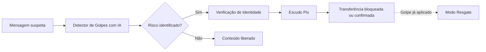

<h1 align="center">GolpeZero</h1>

  
  
  

  <b>Plataforma de proteção contra golpes digitais com Inteligência Artificial, focada em interromper a fraude antes que a vítima perca dinheiro.</b>

---

## Sobre o projeto

O **GolpeZero** é um sistema de prevenção a golpes que analisa mensagens, prints, áudios e links para identificar sinais de fraude e técnicas de manipulação psicológica.

Diferente de soluções que apenas classificam um conteúdo como suspeito, o GolpeZero atua em todo o ciclo do golpe: **detecta** o risco, **confirma** a identidade de quem está pedindo dinheiro, **orienta** o usuário antes de uma transferência e, caso a fraude já tenha ocorrido, **indica os passos** para tentar recuperar o valor.

## O problema

Golpes como o do **falso familiar** exploram urgência, emoção e confiança. A vítima recebe uma mensagem de um número desconhecido, alguém se passa por um parente e pede uma transferência imediata via Pix. Quando a fraude é percebida, o dinheiro já foi enviado.

## A solução

O GolpeZero se posiciona **entre a mensagem e a transferência**, criando pontos de verificação que quebram o padrão de urgência usado pelos golpistas.

## Funcionalidades

### Detector de Golpes com IA

Analisa diferentes formatos de conteúdo recebidos pelo usuário:

| Entrada   | O que é analisado                                              |
|-----------|----------------------------------------------------------------|
| Mensagens | Padrões de texto, pedidos de dinheiro e senso de urgência       |
| Prints    | Conteúdo de capturas de tela de conversas                       |
| Áudios    | Falas com indícios de fraude ou pressão emocional               |
| Links     | Endereços suspeitos e possíveis páginas fraudulentas            |

Além dos sinais técnicos de fraude, o detector identifica **gatilhos de manipulação psicológica**, como urgência, medo, apelo emocional e pedido de sigilo.

### Verificação de Identidade

Quando alguém se passa por um familiar pedindo dinheiro, o sistema permite **confirmar a identidade por meio de um contato previamente cadastrado** pelo usuário, validando se o pedido é legítimo antes de qualquer ação.

### Escudo Pix

Orienta o usuário **antes de realizar uma transferência suspeita**, apresentando os riscos identificados e criando uma etapa de reflexão antes da confirmação do pagamento.

### Modo Resgate

Caso o usuário já tenha caído em um golpe, o sistema **explica como agir** para tentar recuperar o dinheiro, com orientações sobre os próximos passos.

## Diferencial

> O GolpeZero não apenas detecta golpes: ele ajuda a **interromper a fraude antes que a pessoa perca dinheiro**.

| Soluções tradicionais           | GolpeZero                                          |
|---------------------------------|----------------------------------------------------|
| Classificam o conteúdo          | Classificam, verificam e orientam                   |
| Atuam apenas na detecção        | Atuam antes, durante e depois da tentativa de golpe |
| Não validam quem pede o dinheiro | Confirmam a identidade via contato cadastrado       |

## Demonstração

O cenário de apresentação simula um **golpe do falso familiar**:

1. O usuário recebe uma mensagem de alguém se passando por um parente, pedindo uma transferência urgente.
2. A IA analisa a mensagem e identifica os sinais de risco e de manipulação psicológica.
3. O sistema aciona a verificação de identidade junto ao contato previamente cadastrado.
4. A identidade não é confirmada e o Escudo Pix orienta o usuário a não realizar a transferência.

## Potencial de expansão

O projeto foi concebido como um MVP com potencial de integração junto a:

- Bancos
- Instituições financeiras
- Outras instituições interessadas em proteger seus usuários contra fraudes

## Status do projeto

**MVP funcional** — desenvolvido para apresentação, com as funcionalidades de detecção, verificação de identidade, Escudo Pix e Modo Resgate.
